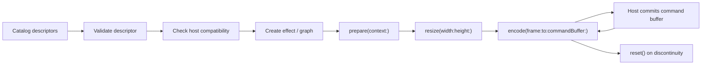

<!-- SPDX-FileCopyrightText: 2026 Daito Manabe -->
<!-- SPDX-License-Identifier: BSD-3-Clause -->

# ContourEffects API manual

このページは、ContourEffects SDKのAPIマニュアルと実行可能Exampleへの入口です。
最短の導入手順は
[CONTOUR_EFFECTS_SDK.md](CONTOUR_EFFECTS_SDK.md)、
外部SDK／モデルとの境界は
[CONTOUR_EFFECTS_THIRD_PARTY.md](CONTOUR_EFFECTS_THIRD_PARTY.md)を先に参照してください。

## Reading path

1. [Core API](../Sources/ContourEffectsCore/ContourEffectsCore.docc/ContourEffectsCore.md)
   でeffect metadata、state、analysis ABI、audio／macro contractを確認する。
2. [Metal API](../Sources/ContourEffectsMetal/ContourEffectsMetal.docc/ContourEffectsMetal.md)
   でrender lifecycle、texture contract、graph compositionを確認する。
3. [Examples](../Examples/ContourEffectsExamples/README.md)を実行し、
   discovery／state、LUT、analysis mask、audio／macro、graph lifecycle、
   edge／flow、Film Look、landmark／detectionの統合方法を確認する。
4. 新しいeffectを書く場合は
   [Writing a New Effect](../Sources/ContourEffectsMetal/ContourEffectsMetal.docc/Writing-a-New-Effect.md)
   に従う。

## Products

| Product | 主な責務 | Metal device |
| --- | --- | --- |
| `ContourEffectsCore` | API version、descriptor、parameter schema、state、timing、analysis payload、audio／macro、dependency metadata | 不要 |
| `ContourEffectsMetal` | Metal effect protocol、frame、analysis texture、effect graph、catalog、Color Grade、3D LUT | 必要 |

対応環境はmacOS 14以降のApple Silicon（`arm64`）、API contractは`1.0`です。
現在SDK catalogへ
公開しているproduction effectはFinal Color Grade / Film Finishの1種類です。
公開APIとして利用できるeffectはcatalogに登録されたentryだけです。

## Canonical lifecycle



全てのmutable APIは、ホストが所有する1本のserial render queueから呼びます。
Effectは渡された未commitの`MTLCommandBuffer`へencodeするだけで、commit、wait、
CPU readbackを行いません。

## Main types

### Discovery and compatibility

| Type | 用途 |
| --- | --- |
| `ContourEffectsMetalCatalog` | SDKに含まれるeffectの列挙と生成 |
| `EffectDescriptor` | ID、API version、input、parameter、dependencyの宣言 |
| `EffectParameterDescriptor` | GUI／automationに使えるparameter metadata |
| `HostCapabilities` | ホストが供給できるinputとdependency |
| `EffectCompatibilityReport` | 不足input、dependency、API versionを報告 |

詳細:
[Descriptors and Compatibility](../Sources/ContourEffectsCore/ContourEffectsCore.docc/Descriptors-and-Compatibility.md)

### Render lifecycle

| Type | 所有者／寿命 |
| --- | --- |
| `MetalEffectHostContext` | ホストがdevice／pixel format／color／alpha contractごとに生成 |
| `MetalEffectInstance` | effect instanceの共通protocol。serial render queueへ閉じ込める |
| `MetalEffectGraph` | effect列と2枚のping-pong textureを所有 |
| `MetalEffectFrame` | 1 output frameだけ有効なtexture／analysis／audio／timing view |
| `MetalAnalysisTextures` | 同一input snapshotから共有する解析texture群 |

詳細:

- [Render Lifecycle](../Sources/ContourEffectsMetal/ContourEffectsMetal.docc/Render-Lifecycle.md)
- [MetalEffectInstance](../Sources/ContourEffectsMetal/ContourEffectsMetal.docc/MetalEffectInstance-Guide.md)
- [MetalEffectGraph](../Sources/ContourEffectsMetal/ContourEffectsMetal.docc/MetalEffectGraph-Guide.md)
- [Frame and Analysis](../Sources/ContourEffectsMetal/ContourEffectsMetal.docc/MetalEffectFrame-Guide.md)

### State and live control

| Type | 用途 |
| --- | --- |
| `EffectValue` | 将来の未知値も保持できるJSON value |
| `EffectStateSnapshot` | effect IDとschema versionを持つ保存単位 |
| `EffectFrameTiming` | capture identity、render time、frame delta |
| `EffectAudioFeatures` | transport非依存のvolume／band／beat／attack |
| `EffectPerformanceMacros` | Energy、Motion、Density、Audio Reactive、Color、Glitch、Feedback、Texture |

`EffectAudioFeatures`と`EffectPerformanceMacros`は、値を受け取っただけでは
任意のparameterを自動で変化させません。各effectまたはhost-side mapperが
意味的な対応を定義します。外部入力は`.clamped()`してからframeへ渡します。

詳細:

- [State and Versioning](../Sources/ContourEffectsCore/ContourEffectsCore.docc/State-and-Versioning.md)
- [Audio and Macros](../Sources/ContourEffectsCore/ContourEffectsCore.docc/Audio-and-Macros.md)

### Analysis data

| Type | Contract |
| --- | --- |
| `EffectPoint` / `EffectRect` | 左上原点、source-normalized UV |
| `EffectLandmarkSet` | providerが追跡中維持するstable IDと固定順序point |
| `EffectObjectDetection` | normalized box、track ID、input-sequence単位のvelocity |
| `MetalAnalysisTextures` | edge、flow、mask、contour、scene、depthのGPU ABI |

初期化子は値を自動normalizeしません。ホストが有限値、範囲、21 hand joints、
19 body joints、texture format／aspect ratioを保証します。

詳細:
[Analysis Data ABI](../Sources/ContourEffectsCore/ContourEffectsCore.docc/Analysis-Data-ABI.md)

### Color grade and LUT

| Type | 用途 |
| --- | --- |
| `ColorGradeConfiguration` | finishing parameterとstarting look |
| `ColorGradeEffect` | display-referred Final Color Grade / Film Finish |
| `CubeLUT` | `.cube` textの検証、parse、load |
| `MetalLUT3D` | device-boundの3D LUT textureとdomain |

`ColorGradeEffect`は`rgba16Float`、display-referred sRGB、straight alpha専用です。
RGBは`0...1`へclampし、alphaは維持します。HDR／bloomはこのpassより前に
実行してください。`renderPresentationSeconds`を渡すとgrainが時間変化します。

詳細:

- [Color Grade](../Sources/ContourEffectsMetal/ContourEffectsMetal.docc/ColorGradeEffect-Guide.md)
- [Cube LUT and MetalLUT3D](../Sources/ContourEffectsMetal/ContourEffectsMetal.docc/CubeLUT-and-MetalLUT3D.md)

## Error handling

- `prepare`または`resize`に失敗したinstance／graphは破棄して作り直す。
- `encode`に失敗したcommand bufferはcommitせず破棄する。
- `MetalEffectError.resizeRequired`はframe pathでallocationせず、次の安全な
  resize pointでgraphを更新する。
- `CubeLUTError`はassetを無効として扱い、LUTなしのeffectへfallbackする。
- `EffectDescriptor.validate()`と`HostCapabilities.compatibility(with:)`は
  instance生成前に実行する。

## Generate DocC

Xcodeに同梱されたDocCを使用します。consumer packageへdocumentation pluginを
追加する必要はありません。

```bash
DEVELOPER_DIR=/Applications/Xcode.app/Contents/Developer \
  xcodebuild docbuild \
  -scheme ContourEffectsCore \
  -destination 'platform=macOS,arch=arm64' \
  -derivedDataPath /tmp/ContourEffectsCore-DocC \
  CODE_SIGNING_ALLOWED=NO \
  OTHER_DOCC_FLAGS='--warnings-as-errors'

DEVELOPER_DIR=/Applications/Xcode.app/Contents/Developer \
  xcodebuild docbuild \
  -scheme ContourEffectsMetal \
  -destination 'platform=macOS,arch=arm64' \
  -derivedDataPath /tmp/ContourEffectsMetal-DocC \
  CODE_SIGNING_ALLOWED=NO \
  OTHER_DOCC_FLAGS='--warnings-as-errors'
```

生成される`.doccarchive`はbuild artifactであり、Gitへcommitしません。

## License

API manual、DocC source、Exampleは
[SDK/SCOPE.md](../SDK/SCOPE.md)に列挙されたfirst-party SDK範囲に限り
BSD-3-Clauseです。再配布時は
[SDK/ATTRIBUTION.md](../SDK/ATTRIBUTION.md)に従って完全なlicense noticeを
同梱してください。
